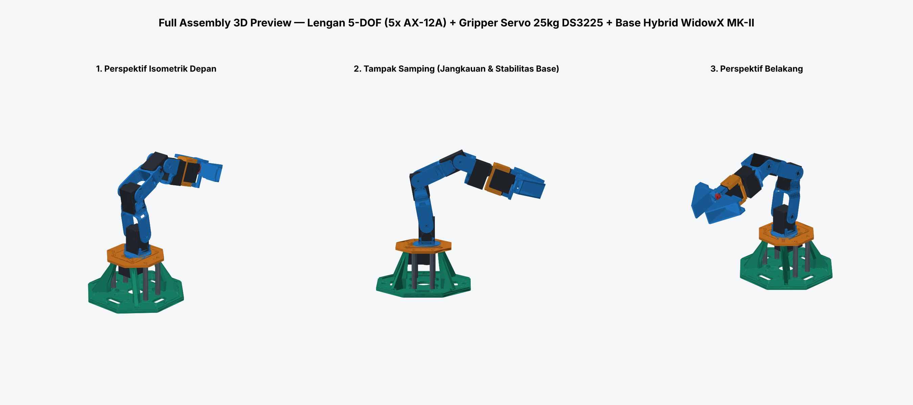

# 01_design — Desain mekanik final

Lengan 5-DOF dengan **5× DYNAMIXEL AX-12A** + gripper paralel yang digerakkan **servo standar 25 kg (DS3225-class)**,
di atas base hybrid WidowX MK-II. Desain lain ada di `99_archive/` hanya sebagai referensi.



| Folder | Isi |
|---|---|
| `stl/` | Part siap cetak (jumlah cetak di nama file `_x1/_x2/_x3`), `00_FULL_ROBOT_ARM_PREVIEW.stl`, katalog & render PNG, `manifest.json` |
| `step/` | `00_FULL_ROBOT_ARM_ASSEMBLY.step` (rakitan utuh + servo), STEP per part, model referensi AX-12A & DS3225 |
| `cad_scripts/` | Generator Python/CadQuery yang menghasilkan `stl/` dan `step/` |
| `source/ax12a_arm_thingiverse_166430/` | Part asli "Robot Arm For AX-12A" (Thingiverse 166430), bahan generator |

## Pemetaan sendi ↔ aktuator

| Aktuator | Sendi (URDF) | Fungsi | Part terkait |
|---|---|---|---|
| AX-12A ID 1 | `joint1_base_yaw` | Putar base | 02, 04, 05 |
| AX-12A ID 2 | `joint2_shoulder` | Bahu (pitch) | 05, 06, 07 |
| AX-12A ID 3 | `joint3_elbow` | Siku (pitch) | 06, 07 |
| AX-12A ID 4 | `joint4_wrist_pitch` | Tekuk pergelangan | 06, 07, 08 |
| AX-12A ID 5 | `joint5_wrist_roll` | Putar pergelangan | 08, **09** |
| Servo 25 kg (PWM, Mega D22) | `joint6_gripper` | Buka-tutup gripper | **09, 10, 11b**, 11, 12 |

## Gripper servo 25 kg — apa yang berubah dari versi AX-12A

| Part | Status | Keterangan |
|---|---|---|
| `09_gripper_cradle_ds3225` | **baru** (ganti `09_wrist_rotate`) | Dudukan U. Dasar dibaut ke horn AX-12A wrist roll (4× M2, PCD 16). Dua dinding menyangga kuping servo; mur M3 masuk dari sisi luar dinding. Ada celah kabel servo. |
| `10_gripper_base_ds3225` | **dimodifikasi** dari `the_crawer_base` | Rel jari asli dipertahankan. Lubang AX lama ditutup, lubang horn diperbesar (R13), ditambah 2 kaki ke kuping servo + pad atas. Dicetak **terbalik** (muka atas di bed) — STL sudah dalam orientasi cetak. |
| `11b_horn_adapter_25t` | **baru** | Dibaut (4× M3 countersunk) ke horn aluminium bulat 25T Ø20 PCD 14. Menyediakan 2 pin tuas di radius 8 mm pada ketinggian yang sama dengan horn AX-12A → **kinematika gripper identik**. |
| `11_the_crawer_lever`, `12_the_crawer_finger` | tidak berubah | |
| `14_servo_ds3225_reference` | referensi | Model kasar servo + horn disc, bukan untuk dicetak |

Sumbu poros servo gripper segaris dengan sumbu wrist roll, jadi gripper tetap simetris saat diputar.
Konsekuensi: ujung gripper ±1 cm lebih jauh dari pergelangan dan ±20–25 g lebih berat dibanding versi AX-12A
(servo 60–67 g vs 54.6 g + cradle lebih besar).

### Perakitan gripper

1. Pusatkan servo (pulsa 1500 µs), pasang horn disc 25T, kencangkan baut tengah horn.
2. Baut `11b` ke horn disc dengan 4× M3x6 countersunk (kepala rata, jangan menonjol).
3. Baut `09` ke horn AX-12A ID5 dengan 4× M2 dari dalam cradle (kepala masuk counterbore).
4. Masukkan servo ke cradle, kuping bertumpu di atas dinding cradle, kabel lewat celah.
5. Pasang `10` dari atas: kaki menapak di kuping servo. Masukkan 4× M3x30 dari atas plat, mur di kantong dinding cradle.
   **Kaki sengaja 1 mm lebih pendek**: tambahkan ring M3 di bawah kaki sampai permukaan atas plat **rata dengan
   permukaan atas adapter 11b**.
6. Pasang tuas (11) ke pin adapter dengan sekrup M2.5 + spacer ±3 mm (sama seperti desain asli: ujung tuas sisi horn
   berada ±3 mm di atas muka horn), lalu jari (12).
7. Uji buka-tutup dengan torque rendah/pulsa bertahap sebelum dipakai menjepit.

### ⚠️ Ukur servo & horn Anda dulu

Dimensi default = DS3225 / servo standar 40×20 mm pada umumnya + horn disc Ø20 PCD 14. Model "25 kg" berbeda merek
bisa berbeda 0.5–2 mm. Ukur dengan jangka sorong lalu ubah parameter di atas
`cad_scripts/build_gripper_ds3225.py`, terutama:

| Parameter | Default | Cara ukur |
|---|---|---|
| `DS_EAR_TOP_BELOW_CASE_TOP` | 11.0 | permukaan atas kuping → permukaan atas case (sisi poros) |
| `HORN_TOP_ABOVE_CASE_TOP` | 5.0 | horn disc terpasang: permukaan atas horn → atas case |
| `DS_CASE_H` | 40.5 | bawah bodi → atas case (tanpa spline) |
| `DS_SHAFT_FROM_END` | 10.0 | pusat poros → ujung bodi terdekat |
| `DS_EAR_HOLE_PITCH_L/W` | 49.5 / 10.0 | jarak lubang kuping |
| `HORN_HOLE_PCD` | 14.0 | jarak lubang M3 horn disc yang berseberangan |

Selisih kecil di dua parameter pertama cukup dikompensasi dengan ring/shim. Selisih lain → generate ulang.

## Regenerasi part

```powershell
cd "F:\Projects\Robot Arm\01_design\cad_scripts"
python -m venv .venv
.venv\Scripts\pip install -r requirements.txt
.venv\Scripts\python build_gripper_ds3225.py          # cek cepat part gripper saja
.venv\Scripts\python build_full_robot_package.py      # semua STL/STEP + render + manifest
```

File STEP rakitan memakai *instance* (part kembar ditulis sekali) dan koordinat dibulatkan ke 1 nm supaya
ukurannya < 25 MB.

## TODO desain

- [ ] **Dudukan Arduino Mega + DYNAMIXEL Shield + PCB daya + buck 6 V.** Base punya boss ArbotiX-M
      (±52.5 × 52.5 mm); Arduino Mega (±101.6 × 53.3 mm) butuh plat adapter / boks samping.
      Model board sudah dikeluarkan dari rakitan sampai posisinya diputuskan.
- [ ] Dudukan saklar, sekring, XT60, baterai LiPo.
- [ ] Verifikasi dimensi servo 25 kg aktual (tabel di atas) lalu cetak `09`, `10`, `11b` dulu sebagai uji pas.
- [ ] Ekspor mesh per link (frame sendi) untuk visual URDF.
- [ ] `06_f4_n_f3_arm_link` (mesh asli) tercatat tidak watertight di beberapa slicer — cek sebelum cetak.
