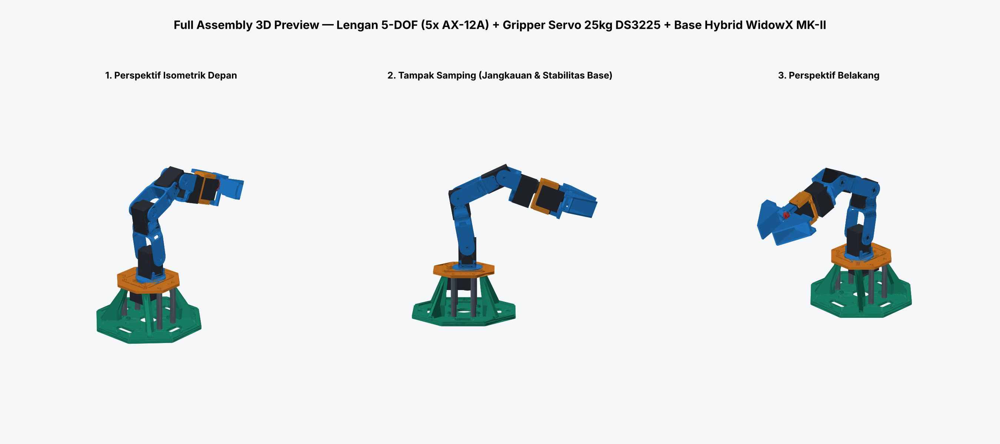

# Robot Arm AX-12A — 5-DOF + Gripper Servo 25 kg

Lengan robot 5-DOF berbasis **5× DYNAMIXEL AX-12A** dengan gripper paralel yang digerakkan **servo 25 kg
(DS3225-class)**, rangka cetak 3D (gabungan Thingiverse 166430 + base hybrid WidowX MK-II + gripper baru),
dikendalikan Arduino Mega + DYNAMIXEL Shield, dengan laptop (ROS 2 Jazzy) sebagai otak.

Dibuat untuk pameran, konten, dan portofolio robotics engineering. Fokus berikutnya: **digital twin**.



📄 **Dokumen rancangan lengkap: [`06_docs/DESIGN.md`](06_docs/DESIGN.md)** — tujuan, keputusan desain,
analisis beban, arsitektur, rencana digital twin, roadmap, risiko.

## Spesifikasi singkat

| | |
|---|---|
| Sendi | Base yaw, bahu, siku, wrist pitch, wrist roll (AX-12A ID 1–5) + gripper (servo PWM 25 kg, Mega D22) |
| Dimensi utama | Sumbu bahu 129 mm dari meja · bahu→siku 92 mm · siku→wrist 92 mm · jangkauan teoretis ±335 mm |
| Controller | Arduino Mega 2560 + DYNAMIXEL Shield (komunikasi), link laptop via USB-TTL di Serial1 |
| Daya | LiPo 3S 3300 mAh → bus AX 11.1 V + buck 6 V untuk servo gripper, PCB distribusi terpisah |
| Software | Firmware `ax12_bridge` v0.2 · ROS 2 Jazzy: description, driver (real/fake), bringup |
| Status | Desain & software dasar selesai, belum dicetak/dirakit |

## Arsitektur

```
┌──────────────────── Laptop (Windows + WSL Ubuntu 24.04, ROS 2 Jazzy) ────────────────────┐
│  RViz / digital twin    Gazebo (nanti)    Vision / ML    Dashboard pameran              │
│               └────────── ax12_arm_driver (pyserial, mode fake) ──────────┘             │
└─────────────────────────────────────────┬──────────────────────────────────────────────┘
                                          │ USB → adapter USB-TTL → Serial1 (115200)
                        ┌─────────────────┴──────────────────┐
                        │ Arduino Mega 2560 + DYNAMIXEL Shield │  firmware: 03_firmware/ax12_bridge
                        └───────┬──────────────────────┬──────┘
                 Serial0 + DIR D2│ 1 Mbps               │ D22 PWM
        ID1 yaw → ID2 bahu → ID3 siku → ID4 wrist pitch → ID5 wrist roll      Servo 25 kg (gripper)
                 ▲ 11.1 V                                                         ▲ 6 V
   LiPo 3S ─ saklar ─ sekring ─ PCB distribusi daya ─────────── buck 6 V ────────┘   (GND bersama)
```

## Struktur folder

| Folder | Isi |
|---|---|
| `01_design/` | Desain mekanik final: `stl/` (siap cetak), `step/` (CAD), `cad_scripts/` (generator parametrik), `source/` |
| `02_hardware/` | Wiring, daya, BOM, PCB daya |
| `03_firmware/` | Sketch Arduino Mega: `ax12_bridge`, tool scan & set ID, spesifikasi protokol |
| `04_ros2_ws/` | Workspace ROS 2: `ax12_arm_description`, `ax12_arm_driver`, `ax12_arm_bringup` |
| `05_apps/` | Aplikasi di atas robot (digital twin, teleop, vision) |
| `06_docs/` | **DESIGN.md**, kalibrasi, build log, media |
| `99_archive/` | Desain referensi, eksperimen lama, gripper versi AX-12A |

## Mulai cepat

1. **Rapikan/arsipkan file lama** (aman dijalankan ulang) — PowerShell:
   ```powershell
   cd "F:\Projects\Robot Arm"
   powershell -ExecutionPolicy Bypass -File .\tidy_repo.ps1          # lihat rencana
   powershell -ExecutionPolicy Bypass -File .\tidy_repo.ps1 -Apply   # eksekusi
   ```
2. **Mekanik**: ukur servo 25 kg Anda dan cek parameter di `01_design/README.md`, lalu cetak `01_design/stl/`.
3. **Hardware**: `02_hardware/README.md` (jumper VIN shield, buck 6 V gripper, common ground).
4. **Firmware**: set ID AX-12A 1–5 dengan `03_firmware/tools/ax12_set_id`, upload `ax12_bridge`.
5. **ROS 2** (WSL): `bash "/mnt/f/Projects/Robot Arm/04_ros2_ws/setup_wsl.sh"`, lalu
   `ros2 launch ax12_arm_bringup demo.launch.py fake:=true` untuk mencoba tanpa hardware.

## Roadmap

- [ ] Fase 0 — Persiapan hardware: ukur servo 25 kg, cetak uji gripper, PCB daya + buck 6 V
- [ ] Fase 1 — Rakit & uji per servo, kalibrasi batas & nol
- [ ] Fase 2 — **Digital twin**: real→twin, twin→real, teach & replay
- [ ] Fase 3 — Simulasi Gazebo + dashboard pameran
- [ ] Fase 4 — Persepsi: kamera, hand-eye, pick & place
- [ ] Fase 5 — Showcase & portofolio

Detail tiap fase dan kriteria selesainya ada di `06_docs/DESIGN.md` §7–8.

## Catatan penting

- Bahu AX-12A hanya kuat menahan lengan ini lurus horizontal secara singkat (perkiraan 0.69 N·m vs pedoman
  0.3 N·m). Kerja dengan siku ditekuk dan benda ringan; lihat `06_docs/DESIGN.md` §5.
- Servo gripper tidak punya feedback; twin menampilkan sudut perintah gripper.

## Kredit

- Part lengan & gripper asli: "Robot Arm For AX-12A Dynamixel Actuators" oleh WebmasterZero, Thingiverse 166430
  (lisensi di `01_design/source/ax12a_arm_thingiverse_166430/LICENSE.txt`).
- Referensi base: Interbotix WidowX MK-II.
